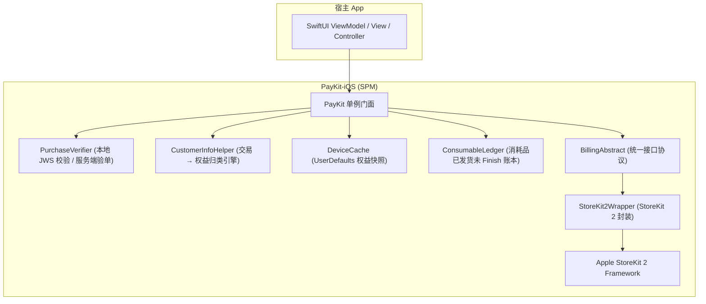
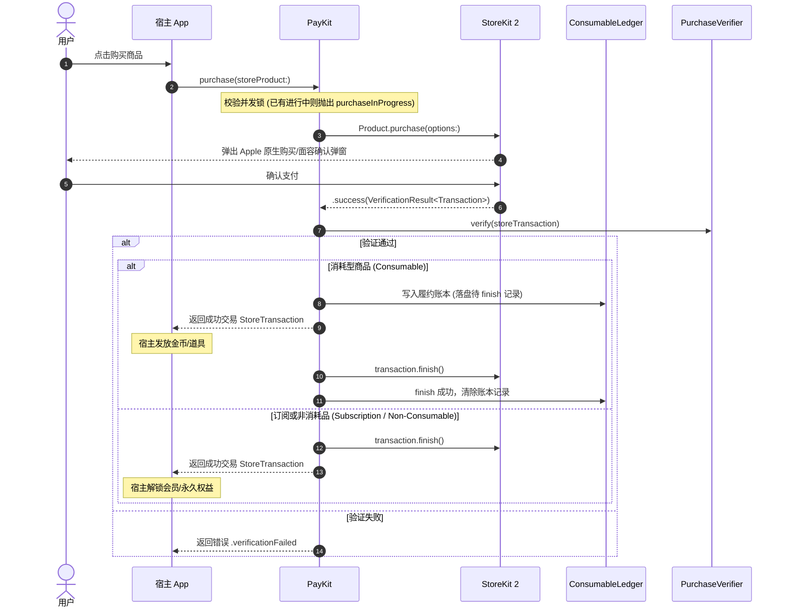

# PayKit-iOS

[](https://github.com/e-hai/PayKit-iOS/releases/tag/1.0.0)
[](https://swift.org/package-manager/)
[](https://developer.apple.com/documentation/storekit)
[](https://swift.org)
[](https://developer.apple.com/documentation/storekit)
[](LICENSE)

**PayKit-iOS** 是一个轻量级、高可靠的 iOS 支付结算 SDK（Swift Package），基于 Apple 原生 **StoreKit 2** 全面采用现代 Swift 并发（`async/await`）构建。

设计哲学与 **PayKit-Android** 深度对齐，提供跨平台一致的 API 语义、错误码模型与数据结构。支持**纯本地无后端秒级接入**，同时具备冷启动秒开、防掉单履约账本与服务端验单扩展能力。

---

## 🌟 核心特性

- **现代 StoreKit 2 架构**：全面使用 Apple StoreKit 2 API，采用 JWS（JSON Web Signature）密码学本地强校验，告别传统 StoreKit 1 繁琐的 OpenSSL 本地收据解析与 Base64 验证。
- **现代 Swift 并发**：API 原生基于 `async/await` 与 `AsyncStream`，同时提供传统 `PurchaseCallback` 闭包协议，兼顾现代与传统代码库。
- **纯本地极速接入**：无需自建鉴权后端，SDK 内置权益计算引擎，直接基于 Apple 凭证计算有效订阅与永久内购。
- **冷启动秒开快照**：基于 `UserDefaults` 的 `DeviceCache` 本地快照，App 启动首屏零延迟立即可用。
- **防掉单履约账本**：针对消耗品（金币/道具）内置 `ConsumableLedger`，发货未 finish 先落盘，从容应对 App 强退、网络闪断，下次启动自动对账补单。
- **并发购买安全防护**：内置单笔交易互斥保护，防止重复点击造成并发购买冲突（抛出 `.purchaseInProgress`）。
- **零成本本地仿真测试**：支持 Xcode `.storekit` 本地配置文件，**无需联网、无需配置 App Store Connect、无需注册 Apple ID**，即可在模拟器中完整测试订阅、内购、自动续费加速与退款。
- **主线程安全调度**：所有面向 UI 的监听器与回调均自动调度至主线程（`MainActor`），可直接安全更新 SwiftUI / UIKit 界面。

---

## 🏗️ 架构与数据流

### 模块分层架构



### 购买核心时序



---

## 📦 集成方式

### Swift Package Manager (SPM)

#### 方式一：Xcode 图形界面添加（推荐）

1. 在 Xcode 中打开您的项目工程。
2. 依次点击菜单：**File $\rightarrow$ Add Package Dependencies...**
3. 在右上角搜索框中输入仓库地址：
   ```
   https://github.com/e-hai/PayKit-iOS.git
   ```
4. **Dependency Rule** 选择 **Exact Version** 并输入 `1.0.0`（或选择 **Up to Next Major** `1.0.0`）。
5. 勾选 `PayKit` 并添加到您的 App Target。

#### 方式二：在 `Package.swift` 中引入

在您的 `Package.swift` 文件中添加依赖项：

```swift
dependencies: [
    .package(url: "https://github.com/e-hai/PayKit-iOS.git", from: "1.0.0")
],
targets: [
    .target(
        name: "YourAppTarget",
        dependencies: [
            .product(name: "PayKit", package: "PayKit")
        ]
    )
]
```

---

## 🚀 快速上手

### 1. 配置商品分类与初始化

在 App 入口生命周期（如 SwiftUI `@main App` 的 `init()` 或 `AppDelegate`）中配置商品 ID 并初始化：

```swift
import SwiftUI
import PayKit

@main
struct PayKitSampleApp: App {

    init() {
        initPayKit()
    }

    private func initPayKit() {
        // 声明商品分类（必须与 App Store Connect 或本地 .storekit 配置一致）
        let configuration = PayKitConfiguration(
            // 自动续期订阅商品 ID
            subsProductIds: [
                "plus_monthly", "plus_yearly",
                "pro_monthly", "pro_yearly"
            ],
            // 消耗型商品 ID (金币/道具)
            consumableProductIds: [
                "coins_100", "coins_500"
            ],
            // 非消耗型永久商品 ID (永久去广告/终身会员)
            nonConsumableProductIds: [
                "lifetime_pass"
            ]
        )

        // 初始化配置并开始监听后台交易
        PayKit.configure(configuration: configuration)

        // 注册全局权益变化监听（可选）
        PayKit.shared.setUpdatedCustomerInfoListener(ClosureCustomerInfoListener { customerInfo in
            let hasPro = customerInfo.activeSubscriptions.contains("pro_monthly")
            let hasLifetime = customerInfo.nonConsumablePurchases.contains("lifetime_pass")
            print("用户权益更新: Pro=\(hasPro), Lifetime=\(hasLifetime)")
        })
    }

    var body: some Scene {
        WindowGroup {
            ContentView()
        }
    }
}
```

---

### 2. 查询商品详情与本地化价格

```swift
Task {
    let productIds: Set<String> = ["pro_monthly", "coins_100", "lifetime_pass"]
    let result = await PayKit.shared.getProducts(productIds: productIds)

    switch result {
    case .success(let products):
        for product in products {
            print("商品ID: \(product.productId)")
            print("商品名称: \(product.title)")
            print("本地化价格: \(product.price)") // 如 "$4.99" 或 "¥30.00"
            print("是否包含免费试用: \(product.hasFreeTrial)")
        }
    case .failure(let error):
        print("查询失败: \(error.message) [Code: \(error.code)]")
    }
}
```

---

### 3. 发起购买流程

#### 方式 A：现代 Async/Await

```swift
func purchaseProduct(_ product: StoreProduct) async {
    let result = await PayKit.shared.purchase(storeProduct: product)

    switch result {
    case .success(let transaction):
        print("购买成功，订单号: \(transaction.orderId ?? "")")

        if PayKit.configuration?.consumableProductIds.contains(product.productId) == true {
            // 1. 若为消耗型商品，在此处发放道具/金币
            grantUserCoins(100)
            // SDK 已自动 finish 交易并清理账本；若中断，下次启动会自动补单
        } else {
            // 2. 订阅或永久商品，SDK 已自动完成确认
            unlockPremiumFeatures()
        }

    case .failure(let error):
        if error.code == .purchaseCancelled {
            print("用户取消了支付")
        } else {
            print("购买失败: \(error.message) [Code: \(error.code)]")
        }
    }
}
```

#### 方式 B：回调协议（主线程自动派发）

```swift
PayKit.shared.purchase(
    storeProduct: product,
    callback: ClosurePurchaseCallback(
        onCompleted: { transaction in
            print("支付成功并已确认: \(transaction.productIds)")
            // 发放权益
        },
        onPending: { transaction in
            print("等待授权（如家庭共享家长审批/银行验证），切勿发货")
        },
        onError: { error in
            print("购买失败: \(error.message)")
        }
    )
)
```

---

### 4. 获取当前用户权益（冷启动秒开）

```swift
// 方式 A：只读本地缓存（首屏秒开，零网络延迟）
if let cachedInfo = await PayKit.shared.getCustomerInfo(forceSync: false) {
    let isVip = cachedInfo.activeSubscriptions.contains("pro_monthly")
    print("当前会员状态: \(isVip)")
}

// 方式 B：从 Apple StoreKit 对账强制同步最新权益（默认）
if let freshInfo = await PayKit.shared.getCustomerInfo(forceSync: true) {
    print("最新有效订阅: \(freshInfo.activeSubscriptions)")
}

// 方式 C：SwiftUI 原生 AsyncStream 监听
Task {
    for await customerInfo in PayKit.shared.customerInfoStream {
        self.activeSubscriptions = customerInfo.activeSubscriptions
    }
}
```

---

### 5. 恢复购买

用户换机、重装应用或同一 Apple ID 跨设备同步时调用：

```swift
func onRestoreClicked() async {
    let result = await PayKit.shared.restorePurchases()
    switch result {
    case .success(let info):
        print("恢复成功，有效订阅: \(info.activeSubscriptions)")
    case .failure(let error):
        print("恢复失败: \(error.message)")
    }
}
```

---

### 6. 消耗品启动补单（防掉单机制）

当用户购买金币/道具成功后，若因 App 崩溃、进程被系统强杀或网络断开导致未能成功交付道具，PayKit 的 `ConsumableLedger` 会记录该笔订单。

在启动时可检查并进行补偿发货：

```swift
Task {
    if let info = await PayKit.shared.getCustomerInfo(forceSync: true) {
        for unfulfilled in info.unfulfilledConsumables {
            print("发现未履约消耗品订单: \(unfulfilled.orderId ?? ""), 商品: \(unfulfilled.productIds)")

            // 1. 业务发货逻辑
            let success = deliverItemToUser(unfulfilled.productIds)
            if success {
                // 2. 标记履约完成，通知 SDK finish 交易并清理账本
                _ = await PayKit.shared.markConsumableFulfilled(purchaseToken: unfulfilled.purchaseToken)
            }
        }
    }
}
```

---

### 7. 自定义服务端验单（可选）

默认使用纯本地 StoreKit 2 JWS 校验。如需在发货前将收据提交至自有后端：

```swift
let customVerifier = PurchaseVerifier { txn in
    // 将 txn.purchaseToken / txn.signature / txn.originalJson 发送给您的后端验单
    let ok = await myBackendService.verifyAppleJws(
        token: txn.purchaseToken,
        signature: txn.signature,
        payload: txn.originalJson
    )
    return ok
        ? .success(())
        : .failure(PayKitError(code: .verificationFailed, message: "服务端验单未通过"))
}

PayKit.shared.setPurchaseVerifier(customVerifier)
```

---

## 🧪 Xcode StoreKit 本地仿真测试指南

iOS StoreKit 2 支持通过本地 `.storekit` 配置文件实现**完全离线、无需 Apple 开发者账号、无需登录 Apple ID** 的全功能仿真：

### 1. 启用 StoreKit 配置
1. 在 Xcode 打开工程，找到或新建 `.storekit` 文件（示例工程内置了 `Sample/PayKitSample.storekit`）。
2. 在 Xcode 顶部选择当前 Scheme $\rightarrow$ **Edit Scheme...**
3. 切换到 **Run $\rightarrow$ Options**。
4. 将 **StoreKit Configuration** 设置为 `PayKitSample.storekit`。

### 2. 本地模拟测试功能
运行模拟器后，您即可直接调试：
- **无感购买**：点击购买直接调用本地测试弹窗，不会产生实际扣费。
- **时间加速模拟**：在 Xcode 菜单 **Debug $\rightarrow$ StoreKit $\rightarrow$ Speed Up Time**，可将 1 个月的订阅加速为数秒自动续订。
- **交易管理与退款**：在 Xcode 菜单 **Debug $\rightarrow$ StoreKit $\rightarrow$ Manage Transactions** 中查看订单，模拟用户申请退款、续费失败、进入宽限期（Billing Retry）等极端场景。

---

## 📊 数据模型与错误码

### CustomerInfo
```swift
public struct CustomerInfo: Sendable, Codable, Equatable {
    public let activeSubscriptions: Set<String>       // 生效中的订阅商品 ID 集合
    public let nonConsumablePurchases: Set<String>    // 永久拥有的非消耗品商品 ID 集合
    public let allPurchaseRecords: [StoreTransaction] // 完整交易记录列表
    public let unfulfilledConsumables: [StoreTransaction] // 待发货的消耗品记录
}
```

### PayKitErrorCode 错误枚举
| 错误码 | 说明 | 应对建议 |
|---|---|---|
| `.purchaseCancelled` | 用户主动取消购买 | 界面恢复常态，无需提示错误 |
| `.purchaseInProgress` | 已有一笔购买在进行中 | 提示用户“正在处理中，请勿重复点击” |
| `.itemAlreadyOwned` | 商品已购买或订阅生效中 | 引导用户恢复购买或提示已拥有 |
| `.productNotAvailable`| 商品未找到或未配置 | 检查 StoreKit Configuration 或 ASC 后台 ID |
| `.storeProblem` | App Store 内部服务异常 | 提示用户稍后重试 |
| `.verificationFailed` | 自定义验单或 JWS 校验失败 | 提示订单校验失败，检查证书配置 |
| `.networkError` | 网络异常 | 提示用户检查网络连接 |

---

## 🔄 跨平台 API 对齐表

| 功能特性 | PayKit Android | PayKit iOS |
|---|---|---|
| **底层引擎** | Google Play Billing Library 9.1.0 | Apple StoreKit 2 Framework |
| **异步范式** | Kotlin 协程 (`suspend`) | Swift 并发 (`async/await`) |
| **持久缓存** | `DeviceCache` (SharedPreferences) | `DeviceCache` (UserDefaults) |
| **防掉单机制**| `ConsumableLedger` | `ConsumableLedger` |
| **验签扩展** | `PurchaseVerifier` | `PurchaseVerifier` |
| **恢复购买** | `restorePurchases()` | `restorePurchases()` |
| **错误枚举** | `ErrorCode` | `PayKitErrorCode` |
| **并发防护** | `PURCHASE_IN_PROGRESS` | `purchaseInProgress` |

---

## 🛠️ 系统环境要求

- **iOS**: 15.0+
- **macOS**: 12.0+
- **visionOS**: 1.0+
- **tvOS / watchOS**: 15.0+ / 8.0+
- **Xcode**: 15.0+
- **Swift**: 5.9+ / Swift 6

---

## 📄 License

```
MIT License

Copyright (c) 2026 PayKit Open Source Project
```
